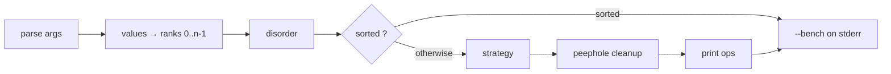
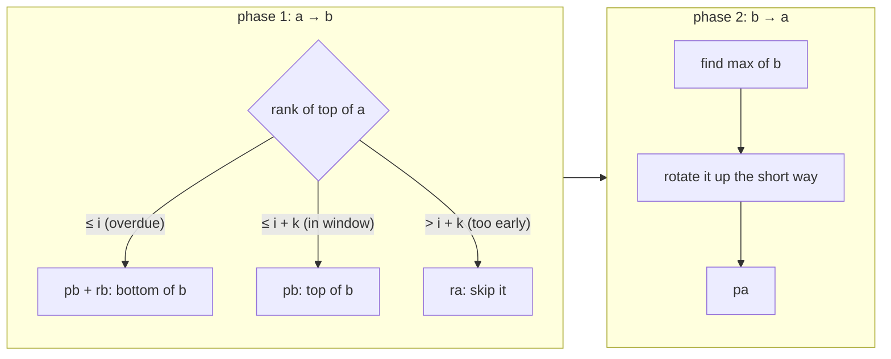
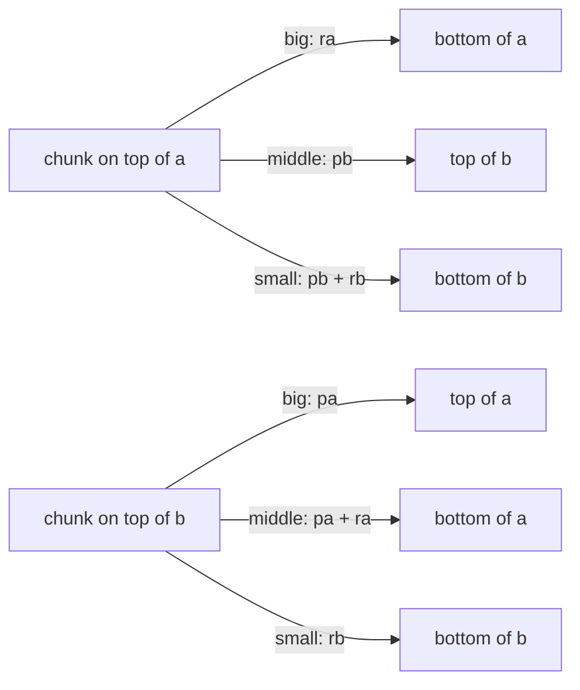
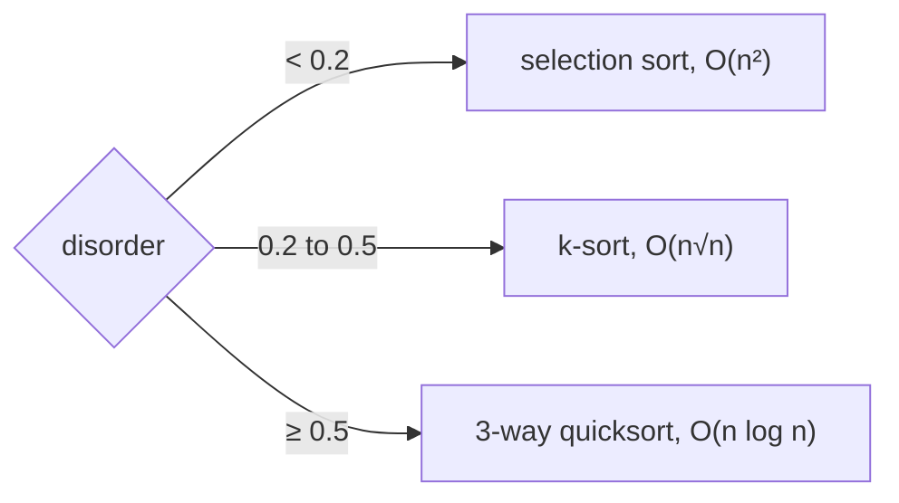
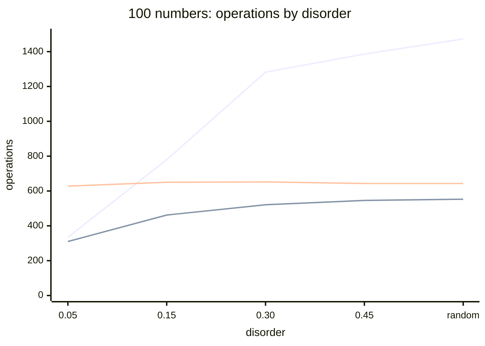

_This activity has been created as part of the 42 curriculum by nfavier, ajanssen._

# push_swap

## Description

`push_swap` sorts a list of integers using two stacks, `a` and `b`, and a fixed set of 11 operations
(`sa sb ss pa pb ra rb rr rra rrb rrr`). The program prints the shortest sequence of operations it can
find that leaves `a` sorted (smallest on top) and `b` empty. Fewer operations means a better grade.

This version of the project asks for **four strategies**, one per complexity class, plus an adaptive mode
that measures how sorted the input already is and picks the strategy that fits:

| Strategy               | Algorithm                                | Class (in operations) |
| ---------------------- | ---------------------------------------- | --------------------- |
| `--simple`             | selection sort (min extraction)          | O(n²)                 |
| `--medium`             | k-sort (sliding-window chunk sort)       | O(n√n)                |
| `--complex`            | 3-way quicksort over two stacks          | O(n log n)            |
| `--adaptive` (default) | picks one of the three above by disorder | depends on the input  |

## Instructions

```sh
make                                   # builds ./push_swap (cc -Wall -Wextra -Werror)
./push_swap 2 1 3 6 5 8                # prints the operations, one per line
./push_swap --complex 4 67 3 87 23     # force a strategy
./push_swap --bench $ARG 2> bench.txt  # stats on stderr, operations still on stdout
```

Check a result with the checker from the project page:

```sh
ARG="4 67 3 87 23"; ./push_swap $ARG | ./checker_linux $ARG
```

Invalid input (non-integer, overflow, duplicate, unknown flag) prints `Error` on stderr. No numbers, or
numbers that are already sorted, print nothing.

**Flags:** `--simple`, `--medium`, `--complex`, `--adaptive`, `--bench`. They can be mixed with the
numbers in any order. If several strategy flags are given, the last one wins.

## Algorithms

### Pipeline



- **Ranks.** Values are replaced by their rank (`0..n-1`) right after parsing. Every algorithm then
  works on a gapless range, so pivots and windows are plain arithmetic.
- **Stacks** are ring buffers of capacity `n`: every operation is O(1), nothing is ever shifted.
- **Every move goes through one dispatcher** that records it in a byte buffer, counts it, and applies it.
  The sort and the output are fully separated: nothing is printed until the sort is done.
- **Peephole cleanup.** Before printing, one in-place pass over the buffer removes pairs that undo
  each other (`pa pb`, `ra rra`, …) and merges pairs that fit in one op (`ra rb` → `rr`). It is compared
  against the last _kept_ op, so cancellations cascade (`ra pb pa rra` → nothing). It saves ~100 ops on
  100 numbers and applies to every strategy.

### Disorder

Disorder is the fraction of pairs `(i, j)`, `i < j`, that are in the wrong order (inversions over
`n(n-1)/2`). It is 0 for sorted input, 1 for reversed input, and about 0.5 for random input. It is
computed once, before any move: O(n²) CPU, zero operations.

### Simple: selection sort, O(n²)

Find the minimum of `a`, rotate it to the top the short way (`ra` or `rra`, whichever is fewer), `pb`.
Repeat until what is left in `a` is already sorted, then `pa` everything back.

**Bound:** each extraction costs at most n/2 rotations plus one push, so at most n²/2 + 2n operations.
**Why here:** on nearly sorted input the next minimum is usually already on top and the early exit
triggers fast. One swapped pair in 100 numbers costs 201 ops (quicksort: 602), in 500 numbers 1,001
(quicksort: 4,205).

### Medium: k-sort, O(n√n)



`i` counts the elements pushed so far, so it is the rank we would expect next if the input were sorted.
The window `(i, i + k]` slides up as elements are pushed. Overdue elements go to the bottom of `b` and
in-window elements stay on top, so `b` ends up roughly ordered, with the biggest ranks near the top. In
phase 2, each maximum is only a few rotations away.

**Window size:** `k = ⌊√(2n)⌋`, which is 14 for 100 and 31 for 500. A small k means more skipping in
phase 1, a big k leaves `b` less ordered for phase 2. We measured k = √n, √(2n) and √(3n) and kept the
best one.
**Bound:** with a window of width k, a sweep of `a` pushes about k elements, so there are about n/k
sweeps of at most n rotations each: O(n²/k). Phase 2 pulls n elements, each within about k positions
of the top: O(n·k). With k ≈ √n, both phases are **O(n√n)**.

### Complex: 3-way quicksort, O(n log n)

A _chunk_ is the set of ranks `low..high` sitting together at the top of a stack. Because ranks have no
gaps, the two pivots are exact: `p0 = low + k/3` and `p1 = low + 2k/3`. Every split gives three equal
thirds.



After a split, each pile is brought back to the top if needed and sorted recursively, always **big,
then middle, then small**: `a` is built from the bottom up, so the biggest ranks must be in place
before smaller ones land on top of them. Chunks of 3 or fewer use hardcoded base cases (no rotations
when other elements sit below, ≤ 2 ops when the chunk is alone in `a`).

**Bound:** every element costs at most 3 operations per level (2 for the split, 1 to rotate back).
Exact pivots give ⌈log₃ n⌉ levels in every case, not just on average, so the total is **O(n log n)**.
Partitioning by rank ignores how sorted the input already is, which is why its count barely moves
with disorder.

### Adaptive



The thresholds are the ones fixed by the subject, and they match what we measured. Average operations
per strategy and disorder, on 100 numbers:



<sub>Lines, top to bottom at 0.45: selection, quicksort, k-sort.</sub>

| n = 500   | disorder 0.05 | 0.15   | 0.30   | random (~0.5) |
| --------- | ------------- | ------ | ------ | ------------- |
| selection | 4,237         | 15,806 | 26,953 | 32,237        |
| k-sort    | 1,796         | 3,918  | 4,766  | 4,911         |
| quicksort | 4,474         | 4,538  | 4,499  | **4,458**     |

- **≥ 0.5:** quicksort, the best on random input at 500 and identical from run to run.
- **0.2 to 0.5:** k-sort uses the existing order. It beats quicksort everywhere at 100 and in the lower
  half of the band at 500. In the upper half at 500, quicksort is ahead by about 5%, which is the price
  of keeping a √n method in this regime.
- **< 0.2:** the subject requires an O(n²) method. Selection is unbeatable when only a few elements
  are out of place (see above), but degrades quickly when many elements are slightly displaced.

**Space:** two stacks of capacity n plus the op buffer (1 byte per op) is O(n + ops), at most O(n²)
bytes for selection in the worst case. Everything else is O(1).

## Performance

Random inputs, default flag (adaptive), measured with the official checker:

| n   | runs | average | worst | target for "excellent" |
| --- | ---- | ------- | ----- | ---------------------- |
| 100 | 1000 | 597     | 673   | < 700                  |
| 500 | 300  | 4,675   | 5,083 | < 5,500                |

`--bench` example (500 random numbers):

```
[bench] disorder: 51.74%
[bench] strategy: Adaptive / O(n log n)
[bench] total_ops: 4468
[bench] sa: 140 sb: 0 ss: 0 pa: 953 pb: 953
[bench] ra: 527 rb: 524 rr: 280 rra: 534 rrb: 536 rrr: 21
```

## Contributions

|          | nfavier                                                                                                            | ajanssen                                                                                     |
| -------- | ------------------------------------------------------------------------------------------------------------------ | -------------------------------------------------------------------------------------------- |
| Core     | ring-buffer stacks, the 11 ops, dispatcher, op buffer, rank normalisation (`src/stack.c`, `src/ops/`, `src/ctx.c`) | argument parsing and validation (`src/args/`), Makefile                                      |
| Sorting  | 3-way quicksort and base cases (`src/sort/quicksort.c`, `src/sort/utils.c`), radix optimisation                    | selection, bubble and k-sort (`src/sort/selection.c`, `bubble.c`, `ksort.c`), original radix |
| Strategy | small-input front door                                                                                             | disorder metric (`src/disorder.c`), adaptive selection (`src/main.c`)                        |
| Output   | peephole cleanup, `--bench`, `ft_dprintf` (`src/output/`, `src/utils/`)                                            |                                                                                              |

Bubble sort and radix sort are kept as baselines we measured against, not used by any strategy.
Both of us reviewed and can explain the whole codebase.

## Resources

- D. Knuth, _The Art of Computer Programming, Vol. 3: Sorting and Searching_
- Cormen, Leiserson, Rivest, Stein, _Introduction to Algorithms_: quicksort, radix sort, lower bounds
- [Quicksort](https://en.wikipedia.org/wiki/Quicksort) and the [Dutch national flag problem](https://en.wikipedia.org/wiki/Dutch_national_flag_problem) (3-way partitioning)
- [Selection sort](https://en.wikipedia.org/wiki/Selection_sort), [Bucket sort](https://en.wikipedia.org/wiki/Bucket_sort), [Radix sort](https://en.wikipedia.org/wiki/Radix_sort)
- [inversions](<https://en.wikipedia.org/wiki/inversion_(discrete_mathematics)>) (the disorder metric)
- [circular buffer](https://en.wikipedia.org/wiki/circular_buffer), [peephole optimization](https://en.wikipedia.org/wiki/peephole_optimization)

### AI usage

We used Claude Opus 5.5 as a sounding board during the project:

- **Documentation:** drafting the README, and comments
- **Understanding the algorithms:** why array algorithms don't port directly to two stacks, how a 3-way
  partition maps onto the four stack ends, the limits of radix sort, and tuning k-sort's window.
- **Review and debugging** of our code: an off-by-one in radix, leaks on the parser's error paths,
  refactors to fit the Norm.

The stack core, the operations, the parser and the sorting algorithms are our own code.
